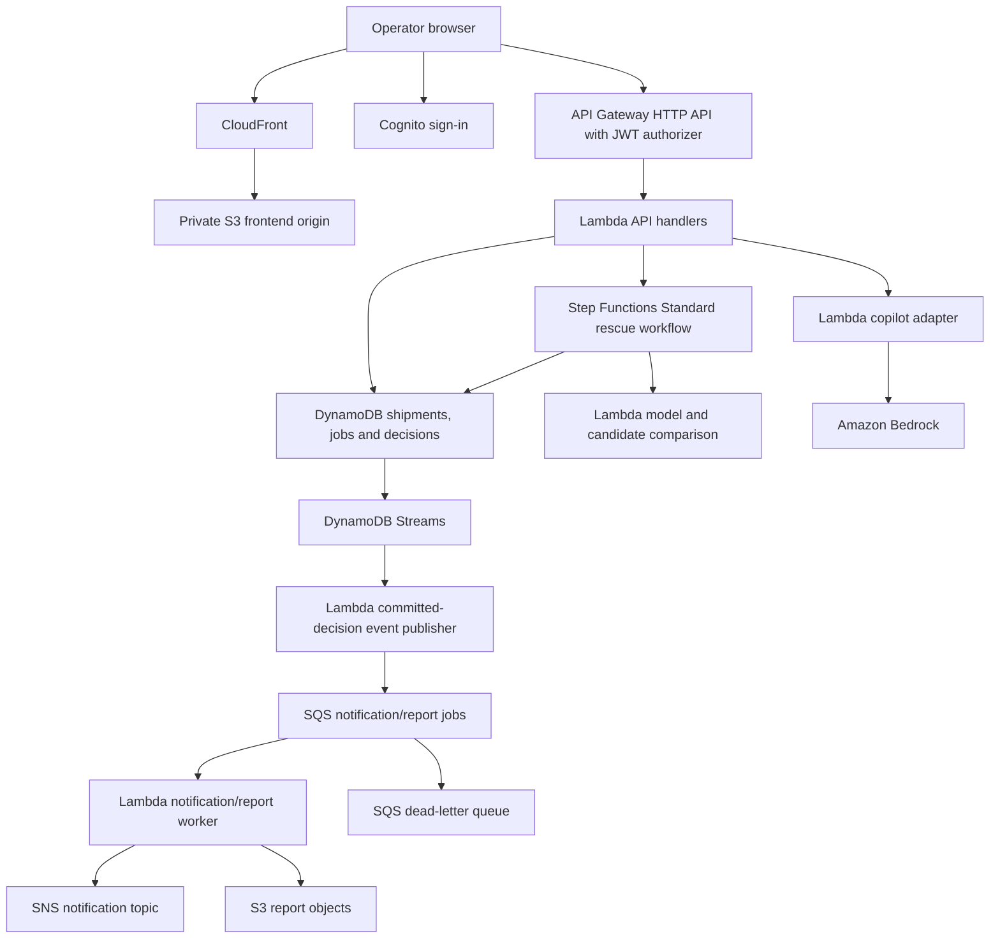

# FreshRoute implementation roadmap

Planning deliverable | 22 October 2026 | BCSE355L Cloud Architecture Design

**Revision:** The expanded [phase-by-phase build blueprint](FRESHROUTE_BUILD_BLUEPRINT.md) is authoritative for the build order, larger feature set, four-bucket storage design, full service audit, and US$200 total planning ceiling. Its phased acceptance gates replace the initial 14-day schedule below. The original model, AI grounding, ownership and evidence requirements still apply.

## 1. Project definition

**FreshRoute: Cloud-based Perishable Shipment Rescue and Decision Support with an AI Copilot.**

FreshRoute helps a food distributor decide what to do when a perishable shipment faces a delay or cooling problem. It estimates quality deterioration, simulates practical responses, ranks feasible rescue plans, explains the recommendation, and records the operator's chosen action.

One-sentence viva explanation: **We use AWS to detect shipment risk, compare possible rescue actions, and help an operator choose an affordable way to reduce estimated food loss.**

Primary user: a small distributor or cold-storage operator. Secondary user: an administrator maintaining produce assumptions and destination capacity. A food bank is a destination type in the first release, not a separate marketplace requiring a second full application.

The current request authorizes a roadmap only. The pasted project text is reference material, not an instruction to implement or deploy now. No application, AWS resources, or model invocations were created for this plan.

## 2. Scope and distinctive features

Build a working decision-support platform with three produce profiles, fictional Indian shipment routes, and seeded accepting destinations. Label all simulated telemetry and example data. Begin with tomatoes, bananas, and leafy vegetables; use documented illustrative parameters until reliable calibration data exists.

The distinctive feature is a closed decision loop:

1. Create a shipment or import a validated CSV temperature history.
2. Observe a delay or temperature excursion, either entered manually or replayed from a seeded event sequence.
3. Compare continuing, improving cooling, rerouting, splitting a shipment, or offering it to an accepting food bank.
4. Reject infeasible options before ranking them.
5. Explain trade-offs in kilograms, rupees, hours, and model assumptions.
6. Have the operator confirm a plan; record its status and event timeline.
7. Show estimated outcomes separately from manually recorded actual outcomes.

Prioritize continuing, cooling, and rerouting first. Add splitting and food-bank allocation only after capacity and reservation logic works.

Do not promise real food-safety certification, scientifically validated spoilage probability, real GPS, road-aware route optimization, or verified carbon/meal equivalents. The map initially uses seeded routes and estimated travel times. Avoid physical sensors, model training, payments, and multi-agent AI in the first release.

## 3. The main demonstration story

A distributor has a fictional 500 kg tomato shipment. A three-hour delay and a cooling excursion trigger a reassessment. The user compares the original plan, extra cooling, and a closer destination. The closer destination has a produce acceptance rule, opening hours, and finite spare capacity, so it cannot automatically accept every shipment.

The operator adjusts the rescue budget and delay slider. The recommendation changes only when the computed feasible options or priorities change. The AI explains the selected result using stored calculations. The operator confirms a plan, and the app records it and emits a notification.

All result values must come from the implemented model. Do not hard-code attractive savings into the demonstration. Include one case where no intervention is feasible and one where continuing is the best option.

## 4. Product and UI specification

Visual direction: an operations dashboard with a warm off-white background, deep green navigation, emerald primary actions, amber warnings, restrained red critical states, rounded panels, readable typography, and generous spacing. Use icons plus text, never color alone. Make desktop the main presentation surface and support mobile forms and comparisons.

| Screen | Main interaction | What makes it useful |
|---|---|---|
| Overview | Select an urgent shipment | At-risk queue, active shipments, estimated avoidable loss, recent events |
| Shipment detail | Inspect temperature and delivery timeline | Route schematic/map, produce, quantity, arrival estimate, model version, data source |
| Rescue Lab | Change delay, temperature, budget, and priorities | Baseline versus three alternatives, freshness curve, loss/cost/time comparison, infeasible reasons |
| Decision detail | Review and confirm a plan | Ranked actions, transparent constraints, AI explanation, confirmation and reservation outcome |
| History | Reopen and compare saved runs | Inputs, model version, timestamps, decisions, estimated versus recorded outcomes |
| Destinations/admin | Maintain receiving capacity | Accepted produce, hours, minimum quality rule, capacity and reservation state |
| Architecture/evidence | Inspect real project evidence | Proposed/deployed/lab-only labels, trace IDs, workflow screenshots and coverage links |

Suggested desktop layout:

```text
FreshRoute | Overview | Shipments | Rescue Lab | History
-------------------------------------------------------
Urgent shipments | Estimated kg at risk | Active plans
-------------------------------------------------------
Shipment route and events       | Shipment risk details
Temperature/quality timeline    | Suggested next action
-------------------------------------------------------
Continue       | Improve cooling       | Reroute
kg at risk     | cost and arrival      | capacity status
-------------------------------------------------------
Delay / temperature / budget controls | AI explanation
```

Essential polish: consistent units, friendly input errors, loading skeletons, progress steps for cloud jobs, empty states, retry controls, keyboard navigation, responsive tables, and a visible simulation-data badge. Keep AWS implementation details on the evidence page rather than interrupting the operator workflow. The copilot is a contextual side panel, not a chatbot that takes over the product.

## 5. Model and optimizer

Keep the calculation independent of AWS and the LLM so it runs locally and is testable.

An illustrative temperature-exposure model:

```text
equivalent_age_hours = prior_age_hours
                     + sum(duration_hours * Q10^((temperature_C - reference_C)/10))
quality_fraction = initial_quality_fraction * exp(-decay_per_hour * equivalent_age_hours)
```

Define `initial_quality_fraction` at the start of the modeled history. To avoid counting deterioration twice, choose either a current measured starting quality with prior_age_hours = 0, or an earlier initial quality with explicit prior exposure. Cooling changes only future segments; it cannot restore lost quality. Apply the same convention to every candidate.

Q10, decay constants, reference temperature, initial quality, and acceptable-quality thresholds are illustrative produce parameters until calibrated. Bound the supported temperature range; this formula omits effects such as chilling injury and is not universally valid. Name the result a **quality deterioration index**, not a spoilage probability.

For quantity estimates, model a shipment as a small set of weighted quality cohorts and sum cohort weights below the stated threshold. This is more defensible than declaring that a 40% risk score means exactly 40% of the shipment spoils. Both cohort profiles and quantity estimates remain assumptions. Show sensitivity to parameter uncertainty rather than invented confidence intervals.

Optimizer sequence:

1. Generate a finite list of intervention candidates.
2. Reject those violating budget, receiving hours, available capacity, produce acceptance, travel-time constraints, or modeled minimum quality.
3. Compute each feasible option using the same model and parameters.
4. Rank by normalized estimated loss, intervention cost, and arrival time. Weights sum to one; use fixed documented normalization ranges so changing the candidate set does not unpredictably change scores.
5. Break ties by lower loss, then lower cost, then shorter time, then stable candidate ID.
6. Display the raw metrics, score, rejected options, and reason for the winner. Also identify alternatives with better individual trade-offs.

Include produce value/kg and modeled avoided loss value as optional economics. Keep intervention cost, value recovered, and net modeled benefit separate. Dashboard totals must not double-count multiple scenarios for the same shipment or describe predicted savings as realized savings.

## 6. LLM integration: FreshRoute Copilot

Use Amazon Bedrock through a backend adapter. Start with a small text model available to the target account and region. Nova Micro is a candidate; AWS currently lists Mumbai access through geographic cross-region inference rather than direct in-region invocation. Verify the current model/profile ID, allowed destination regions, access, and price before implementation. Do not hard-code an assumed Mumbai model endpoint.

Three useful capabilities:

- **Explain this result:** describe why the deterministic winner beat the alternatives using the stored metrics and constraint reasons.
- **Draft a what-if scenario:** convert a request such as “add two hours of delay and cap cooling spend at Rs 800” into validated structured inputs. Show the parsed form for confirmation before running.
- **Generate a rescue brief:** produce a concise operator summary from a completed run, including assumptions and the chosen action.

The prompt receives only the selected shipment, computed alternatives, relevant parameter notes, and allowed response fields. Return a validated structure containing explanation, referenced scenario IDs, assumptions, and suggested follow-up questions. Check quoted numbers against stored results; reject unsupported claims and display a deterministic template if validation fails.

The LLM cannot choose new numerical results, change rankings, reserve capacity, send notifications, certify food safety, or execute actions. Treat user text as untrusted data. Require operator confirmation for writes. Keep model IDs, prompt versions, token counts, and result provenance; avoid logging raw user prompts by default.

Use a small output-token limit, bounded retries, a per-user request allowance, and a cache keyed by scenario result hash plus model and prompt version. If Bedrock fails, the complete simulation and recommendation still work. Label template output as a fallback, not as live AI.

Do not add a vector database simply to say “RAG.” Initial explanations use stored results and a small set of relevant authored parameter notes. A cited agricultural-document retrieval extension is a later feature if evidence quality and retrieval evaluation justify it.

## 7. Proposed AWS architecture

Technology choices: React + TypeScript + Vite, Tailwind CSS, reusable accessible UI components, a charting library, Python calculation modules and Lambda handlers, AWS SAM/CloudFormation, and PowerShell scripts. A local API adapter and local persistence allow development without cloud credentials. Avoid a separate always-running application server in the primary deployment.



Cross-cutting: IAM roles, CloudWatch logs/metrics/alarms, CloudTrail audit evidence, AWS Budgets, encryption and infrastructure as code. Add one scoped KMS report-encryption lab or deployment feature after pricing review; default S3 encryption by itself is not proof of a customer-managed KMS integration.

Service responsibilities:

| Service | Concrete responsibility |
|---|---|
| S3 | Private frontend files, model parameter versions, optional generated reports |
| CloudFront | HTTPS static delivery and caching through S3 Origin Access Control |
| Cognito | User authentication; backend separately checks shipment ownership and roles |
| API Gateway HTTP API | Authenticated application endpoints and request throttling |
| Lambda | Validation, calculations, candidate generation, persistence and integration logic |
| DynamoDB | Key-based shipment lookup, per-owner shipment history, run/job lookup and conditional decision writes |
| Step Functions Standard | Visible validation, calculation, comparison and result-persistence workflow with failure handling |
| DynamoDB Streams | React to a transition into a committed decision state |
| SQS and DLQ | Buffer report/notification work independently of user requests and capture poison jobs |
| SNS | Deliver an opt-in confirmed demo email notification |
| Bedrock | Explain existing results and draft structured scenarios |
| CloudWatch | Application logs, latency, workflow failure and queue alarms |
| CloudTrail | Audit supported AWS control-plane activity; explicitly configure needed data events separately |
| IAM | Least-privilege per-component roles and documented administrator access |
| Budgets | Billing alerts; not a hard real-time cap |
| SAM/CloudFormation | Repeatable resource creation, configuration, updates and cleanup |

DynamoDB is chosen for this particular plan's fixed ID/history access patterns and event-stream integration. Reconsider a relational primary database if the product grows into arbitrary cross-organization queries, complex joins, and extensive SQL reporting. Do not duplicate the production data into RDS just for service count.

A private S3 REST origin with CloudFront OAC is the plan; do not use the S3 website endpoint with OAC. API calls go to API Gateway over HTTPS with narrowly scoped CORS. If WAF is demonstrated only on the static CloudFront distribution, explicitly state that it does not protect a directly callable API endpoint. API WAF protection needs a suitable API architecture and a separate design review.

## 8. Request and event behavior

Suggested endpoints: create/list/get shipments, submit/get a rescue run, explain a completed run, list destinations, confirm a decision, and obtain an authorized report link. Return 202 with a run ID for cloud workflow submissions; poll a job endpoint until completion. Debounce what-if controls and run a small local preview; explicit “Run cloud analysis” performs the authoritative saved calculation using the same model version.

Keep a simple schema: Shipments, Runs, Destinations, and Decisions/Jobs. Enforce ownership server-side from authenticated claims, never from a client-supplied owner ID. Store large report data in S3 rather than database items. Record model version, input hash, scenario ID and timestamps.

Use a conditional update or transaction when reserving destination capacity and recording a decision. Re-check capacity at confirmation because an earlier simulation is not a reservation. If capacity changed, return an understandable conflict and offer recomputation. A shipment decision does not claim an external food bank actually accepted delivery unless a real confirmation integration exists.

Streams/SQS consumers must tolerate duplicate events. Deduplicate by decision/event ID, filter meaningful state transitions, configure partial batch failure handling and a redrive policy, and prevent event loops. For external email, acknowledge the small duplicate-delivery window rather than claiming exactly-once delivery. Cloud run states: QUEUED, RUNNING, SUCCEEDED, FAILED; errors retain a traceable ID without exposing sensitive details.

## 9. Complete syllabus coverage plan

Status key: **Core** = planned working application feature; **Lab** = separately testable small deployment, subject to account/budget; **Study** = explained design, comparison or legacy case study. None are claimed deployed today. Covering a topic through a study is not equivalent to implementing it. Confirm with the faculty whether studies/labs satisfy their project expectations; the supplied syllabus does not specify the 20-mark project rubric.

| Module | Every listed topic and planned evidence |
|---|---|
| 1: Foundations and IAM | **Core:** cloud concepts through on-demand services; AWS global infrastructure through a region/AZ/edge diagram; shared responsibility through an owner matrix; IAM users/groups/policies/roles/best practices through documented human access design and real service roles. Explain users/groups without creating unnecessary long-lived keys. |
| 2: Compute and storage | **Core:** AWS compute/storage overview, Lambda comparison, S3 objects, storage classes and lifecycle configuration. **Lab:** EC2 instance types, On-Demand/Spot/commitment pricing comparison, launch-stop-start-terminate lifecycle, EBS, two-AZ Auto Scaling and ELB architecture with a brief ALB health-check/scaling test if feasible. **Study or bounded lab:** EFS shared-file use; Glacier archival/restore and lifecycle trade-offs including minimum retention/retrieval costs. No fake archive transition evidence. |
| 3: Networking and content delivery | **Core:** CloudFront and edge delivery. **Lab:** VPC, public/private subnets, route tables, security groups, two-AZ layout and VPC peering with a connectivity and blocked-access check. **Study:** Direct Connect between a large warehouse network and AWS, compared with VPN and ordinary internet connectivity. Serverless resources are not falsely drawn inside a customer VPC. |
| 4: Databases | **Core:** DynamoDB and Streams with an observable decision event. **Study plus optional short RDS lab:** RDS as a legacy warehouse SQL system; Multi-AZ for availability; read replicas for read scaling; Aurora as a relational alternative. Show the distinct purposes of standby and read replica, schema, access patterns and cost comparison. A single RDS instance is not evidence of a working Multi-AZ setup. |
| 5: Management and cost | **Core:** CloudWatch, CloudTrail, AWS Cost Management/Cost Explorer, Billing/account management, Free Tier/account eligibility and AWS Budgets. **Lab:** AWS Config restricted resource/rule experiment; Systems Manager Session Manager for the EC2 lab with suitable connectivity and instance role. **Study/account evidence:** Trusted Advisor checks and account/support-plan limitations. Do not claim unavailable checks ran. |
| 6: Security/compliance | **Core:** shared responsibility, access control, TLS, secure storage, validation, ownership tests and security best practices. **Lab/extension:** KMS encryption and access-denied proof; a scoped WAF rule and blocked request. **Study/evidence:** Shield Standard versus Shield Advanced and the scope of protection actually applicable to the chosen services. Never perform a DDoS test. |
| 7: Integration and architecture | **Core:** SQS, SNS, Step Functions; demonstrate a queue retry and failure handling. **Study:** SWF versus Step Functions and why the latter fits this workflow. Apply all six Well-Architected pillars: operational excellence, security, reliability, performance efficiency, cost optimization and sustainability. Show scalability versus elasticity, managed multi-AZ availability, bounded retries, fault tolerance and cost decisions. Do not claim multi-region disaster recovery. |
| 8: Migration and hybrid | **Study:** a legacy warehouse migration with DMS full-load/change-data-capture to RDS, reconciliation, cutover and rollback; SMS as a legacy syllabus topic with Application Migration Service as the modern comparison; Snowball/Snowball Edge offline import and edge-compute concepts; Snowmobile as a historical large-volume transfer case. Add Direct Connect/VPN hybrid connectivity and alternatives such as DataSync. **Optional lab:** a tiny DMS migration only if feasible. Uploading CSVs is not a DMS migration. |

Important syllabus update: AWS documentation recommends Application Migration Service rather than SMS. AWS Snowball is closed to new customers, and AWS currently announces commercial-region Snowball support ending on 31 December 2026. Treat this as evidence of informed service selection, not an excuse to omit the syllabus topics. Explain historical use cases and current alternatives. Do not plan to order Snow hardware.

## 10. Implementation sequence and acceptance gates

Planning assumption: approximately 14 focused working days for a team of three, with existing web basics; allow 3-4 weeks for a beginner team, account restrictions, or an unfamiliar stack. Rework the schedule once the actual deadline is known.

| Phase | Approximate effort | Deliverable and completion gate |
|---|---|---|
| 1. Freeze design | Day 1 | Final scope, screen wireframes, data model, architecture, syllabus matrix, parameter assumptions and faculty rubric questions |
| 2. Build calculation core | Days 2-3 | Local model, cohort estimates, feasibility filters and optimizer; reproducible fixtures and boundary/monotonicity/tie-break tests pass |
| 3. Build polished local product | Days 4-6 | Dashboard, shipment form, Rescue Lab, history, destination constraints and report view; complete main demo without AWS |
| 4. Deploy thin cloud path | Days 7-8 | SAM resources, frontend, Cognito, API, Lambda and DynamoDB; one real user-owned scenario persists and a second user cannot access it |
| 5. Add workflow and events | Days 9-10 | Step Functions, decision stream, SQS/DLQ, report worker and SNS; duplicate/retry/conflict scenarios tested and evidenced |
| 6. Add copilot | Day 11 | Bedrock grounded explanation, validated what-if draft, caching and graceful timeout; numeric consistency and prompt-injection cases pass |
| 7. Labs and quality | Days 12-13 | Required affordable labs, security checks, responsive QA, scoped performance test, cost review and cleanup rehearsal |
| 8. Package evaluation | Day 14 | Report, architecture diagrams, real evidence, short demo video, slides, viva preparation and final rehearsal |

Deploy in layers rather than introducing every cloud component on day one. The final target includes the event-driven path and working LLM integration; the thin cloud path is an intermediate checkpoint, not the final project.

If time becomes tight, remove splitting, CSV import, generated downloads, and sophisticated maps before removing core correctness, ownership enforcement, the live cloud path, failure evidence, or LLM grounding. No implementation has been performed as part of this roadmap.

Team split: (1) UI and interaction quality; (2) calculation/API/data design; (3) AWS infrastructure, monitoring and evidence. Share integration checkpoints and rotate viva explanations so every member can explain the whole system.

## 11. Verification and evidence

- Model: zero duration, no cooling recovery, supported temperature boundaries, unit consistency, reproducibility and sensitivity; do not assert universal monotonicity outside modeled ranges.
- Optimizer: tight budgets, missing receiving capacity, closed destinations, tie scores, no feasible option and no-benefit interventions.
- Product/API: invalid CSV and inputs, refresh/reopen history, job failure states, unauthorized cross-user access, confirmation conflicts and responsive/keyboard operation.
- Reliability: injected worker failure, DLQ routing, replay with the same event ID, workflow retry/catch path and report/SNS outcome evidence.
- AI: changed numeric claims, irrelevant requests, prompt injection, timeout, repeated request caching and fallback labeling.
- Deployment: infrastructure validation, stack outputs, HTTPS, private bucket access denial, least-privilege checks, alarms and cleanup preview.

For every claimed service, keep a feature-to-resource-to-evidence entry: resource/stack identifier, console or API evidence, app action, relevant timestamp and screenshot. Store real measured results separately from target expectations. Load testing is bounded and authorized before cloud execution; report actual p95 latency and failures without invented targets or uptime claims.

## 12. Cost and deployment boundaries

No price promise is made. Plan a small evaluation workload: three users, 100 saved rescue runs, up to 30 copilot requests, less than 100 MB of sample/report data, and short retained logs. These are estimate inputs, not guaranteed spend limits.

Before deployment, calculate current regional service costs, account credits/Free Tier eligibility, request counts, state transitions, tokens, log ingestion, storage and transfer. Separate the ongoing serverless estimate from hourly networking/database lab costs. Review KMS keys, WAF, Config, ALB, EC2/EBS, EFS and RDS individually. Deleting or stopping compute does not automatically remove storage, snapshots, load balancers, logs, keys, or network charges.

Use bounded Lambda concurrency, API throttles, Bedrock token/request allowances, short log retention, lifecycle/TTL rules, and explicit switches for optional lab stacks. Budget alerts are delayed notifications, not a hard cap. Avoid NAT gateways, paid domains, persistent relational clusters and commercial map APIs in the primary student deployment unless a concrete requirement justifies them.

Provide a resource inventory, tagged stacks, PowerShell deployment/check/cleanup commands, a deletion preview and a retained-data decision. Deployment must follow an explicit resource/cost review with the user; this document does not deploy anything.

## 13. Evaluation package and demo

Deliver: runnable source, dependency locks, parameter/sample datasets, model and optimizer tests, frontend build, SAM templates, setup/deployment instructions, security and cost notes, cleanup procedure, syllabus matrix, architecture decisions, evidence index, report, slides and a recorded backup demo.

Suggested 7-minute presentation:

1. 0:00-0:40: user, problem and project objective.
2. 0:40-2:30: shipment incident, comparison, budget change and feasible recommendation.
3. 2:30-3:10: grounded AI explanation and one validated what-if request.
4. 3:10-4:00: confirm action, history and notification/report result.
5. 4:00-5:15: trace the actual AWS workflow and queue failure/retry evidence.
6. 5:15-6:15: show security, cost and deployment decisions.
7. 6:15-7:00: syllabus coverage, short lab evidence and legacy-service migration story.

Internal quality target, not an official marking rubric: 5 points for a coherent working application, 5 for justified cloud integration, 3 for model/AI explanation, 3 for security/reliability/cost evidence, 2 for usability and 2 for presentation. Replace this checklist with the faculty's actual rubric when available; no roadmap can guarantee 20/20.

## 14. Reference sources

Syllabus source: C:\Users\SURESH D KOTADIA\Desktop\sem 5\cad\CLOUD-ARCHITECTURE-DESIGN.pdf, modules 1-8 on pages 1-2. The supplied syllabus contains no specific 20-mark project scoring rubric.

Project context: the two user-supplied pasted notes describing FreshRoute and the broader master project prompt. Unrelated personal chat lines were ignored.

AWS facts checked on 22 October 2026; verify account access, availability and prices again at implementation:

- Bedrock regional model support: https://docs.aws.amazon.com/bedrock/latest/userguide/models-region-compatibility.html
- Nova Micro model card: https://docs.aws.amazon.com/en_en/bedrock/latest/userguide/model-card-amazon-nova-micro.html
- Private S3 origin and CloudFront OAC: https://docs.aws.amazon.com/AmazonCloudFront/latest/DeveloperGuide/private-content-restricting-access-to-s3.html
- Lambda/SQS processing and duplicates: https://docs.aws.amazon.com/lambda/latest/dg/with-sqs.html
- AWS Budgets notification delay: https://docs.aws.amazon.com/cost-management/latest/userguide/budgets-managing-costs.html
- SMS product update recommending MGN: https://docs.aws.amazon.com/sdk-for-go/api/service/sms/index.html
- Snowball commercial-region end-of-support notice: https://aws.amazon.com/snowball/
- Snowball existing-customer restriction: https://aws.amazon.com/blogs/storage/aws-snow-device-updates/
