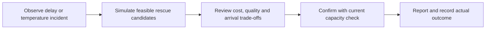
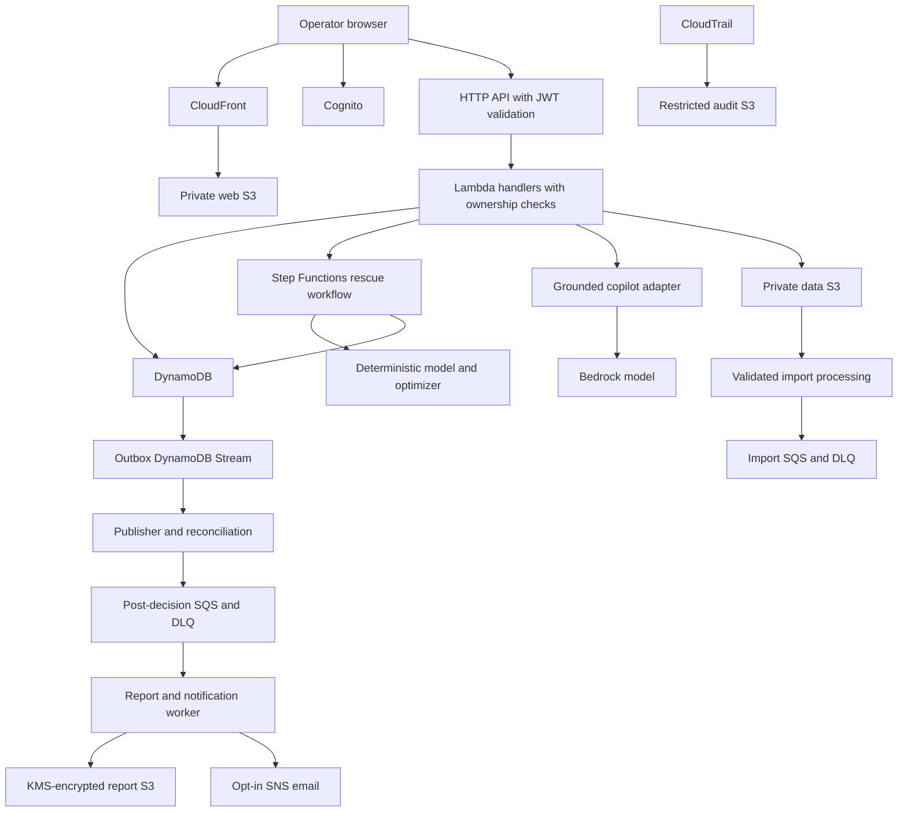
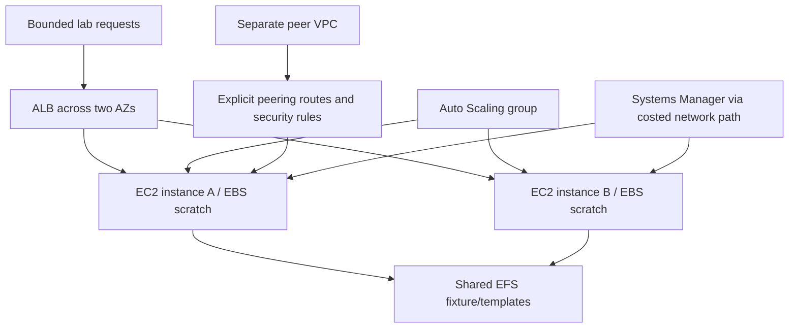

# FreshRoute cloud resource and evaluation plan

Status: proposed resources and experiments. No deployment, current price quote or account inspection completed in Phase 0.

## Resource boundaries

| Stack | Proposed resources | Lifecycle |
|---|---|---|
| foundation | IAM roles, data/reports/audit S3 buckets, scoped KMS key, CloudTrail configuration and log retention | Retain for demonstration period; explicit data cleanup |
| web | Web S3 bucket, CloudFront distribution and OAC | Main application; build outputs deploy here |
| identity-api | Cognito, API Gateway HTTP API, API Lambda handlers | Main application; actual auth starts Phase 4 |
| data-workflow | Four DynamoDB tables, required indexes/Streams, Step Functions and calculation handlers | Main application; immutable run versions |
| background | Import and post-decision SQS queues + two DLQs, workers and SNS | Main application; opted-in demo notification only |
| ai | Bedrock adapter configuration, least-privilege model invocation role, usage limits | On-demand model calls, no provisioned throughput |
| operations | CloudWatch dashboard/alarms and billing-alert configuration | Scoped monitoring; billing setup may be account-level |
| lab-compute-network | Two-AZ VPC/subnets/routes/SGs, ALB, launch template/ASG up to two EC2 instances, EBS/EFS; separate peer VPC | Short-lived and independently deletable |
| lab-sql-migration | Disposable SQL fixtures, RDS and optional DMS resources | Run only after cost/connectivity preflight |
| lab-security | Scoped Config and WAF compatible-resource experiment | Short-lived; no paid Shield Advanced subscription |

Avoid circular stack dependencies: core state/storage outputs feed API/workflow roles; event consumers refer to explicit sources. Identity/API outputs feed generated frontend runtime config. Export only what dependent stacks need. CloudTrail/KMS policies require careful service permissions; do not generate wildcard policies merely to avoid dependency errors.

## Four-bucket contract

| Bucket | Writers/readers | Retention and proof |
|---|---|---|
| web | Deployment writes, CloudFront OAC reads; no general public S3 reads | HTTPS app works, direct S3 denied, release rollback documented |
| data | Authorized presigned upload keys; scoped importer and model readers; admin parameter publisher | Quarantine cleanup, selected parameter versioning, upload/schema/access proof |
| reports | Report worker writes, owner-checking API signs download | KMS permissions, expiration, authorized/unauthorized link tests |
| audit | CloudTrail service delivery and scoped export jobs; restricted audit reader | Appropriate encryption/delivery policy, no recursive logging, actual event arrival |

Block public access on every bucket. Do not archive active UI assets or tiny hot parameter files just to demonstrate a storage class. Lifecycle configuration proof and observed transition/restore proof are distinct. Cleanup must account for noncurrent versions and retained audit data.

## Architecture diagrams for the presentation

### Business flow

### Main deployment

The diagram shows logical flow; exact S3 import event wiring is selected in Phase 5. Presigned upload alone does not make an import trusted. IAM, TLS, monitoring and retention apply across resources; they are not decorative boxes. Main Lambda functions do not need to be placed in the customer VPC merely to show VPC use.

### Engineering lab

Show subnet/route/SG details on a separate network diagram at implementation. A private instance needs endpoints or another egress path for SSM/packages; public IPv4, endpoints and NAT each require cost review. Use fictional fixtures on lab endpoints, not unauthenticated production data.

## Syllabus audit result

Every named topic in the supplied eight-module syllabus is included in section 6 of FRESHROUTE_BUILD_BLUEPRINT.md. Carry that service-by-service matrix forward as the authoritative coverage list.

Core: IAM, shared responsibility, S3/classes/lifecycle configuration, CloudFront, DynamoDB/Streams, CloudWatch, CloudTrail, billing/cost/Budgets, KMS, SQS, SNS, Step Functions and architectural principles. Labs: EC2/types/pricing/lifecycle, Auto Scaling, ELB, EBS/EFS, VPC/subnets/routes/SGs/peering, SSM, Config, WAF, RDS and a budget-dependent DMS experiment. Studies: Direct Connect, SWF, Aurora, RDS standby/read-replica comparisons where not deployed, Shield distinctions, SMS, Snowball/Edge and Snowmobile.

Glacier archive/restore is a bounded experiment if feasible, otherwise an explicitly labeled study. Free Tier, account management and Trusted Advisor use actual account eligibility/evidence, with unavailable checks identified. No topic is silently excluded, but complete conceptual coverage is not complete deployment coverage. The faculty's acceptance of the split remains an external assumption.

## Experiments that demonstrate depth

| ID | Experiment | Evidence required |
|---|---|---|
| E01 | Normal rescue run | Input/version, workflow trace, persisted output and matching UI |
| E02 | Cross-user access denied | Two identities, request result and no unauthorized read/write |
| E03 | Capacity contention | Competing confirmations; only valid reservation succeeds |
| E04 | Worker poison message | Retry history, DLQ arrival and controlled replay result |
| E05 | AI unavailable | Bounded failure, labeled fallback and still-working analysis |
| E06 | S3/KMS permissions | Allowed workflow, unauthorized denial and encrypted report metadata |
| E07 | ALB/ASG resilience | Target health, instance failure/replacement and observed request behavior |
| E08 | EBS/EFS distinction | Per-instance scratch versus matching shared-file reads |
| E09 | Peering and isolation | Routes, permitted connectivity and blocked path |
| E10 | WAF/Config | Benign test request blocked; scoped configuration change/recheck |
| E11 | RDS/DMS migration | Actual source/target compatibility, counts/content reconciliation; otherwise Study label |
| E12 | Cleanup and cost | Inventory before/after deletion and actual retained-resource charges |

Never label a test passed until it runs. Use observed values, not invented p95 latency, uptime, food savings or AI accuracy.

## Budget and cost-review worksheet

Retain the blueprint allocations: main app US$35, Bedrock US$10, compute/network labs US$35, SQL/migration US$45, security/observability US$20, contingency US$55. Total US$200. These are maximum planning allocations, not price estimates or monthly recurring limits.

For every proposed deployment fill: resource, region, pricing date/source, hourly/request/storage/token unit, quantity, active duration, gross estimate, applicable credit/expiry, residual estimate, cleanup operation and owner. Cost model = usage * applicable rates + retained resources/transfer/tax as applicable. Do not subtract uncertain credits from the gross ceiling calculation.

Decision gate: if a lab does not fit its allocation after exact pricing, shorten it, redesign it or use a transparent study. Do not spend contingency merely to increase service count. Alerts are delayed notifications, not hard spending caps. No deployment is authorized by this Phase 0 design document.

## Evidence index schema

Use EVIDENCE_REGISTER.csv. One row per experiment; add service-specific rows as deployment proceeds. Fields: evidenceId, topic, treatment, status, feature, resourceReference, expectedBehavior, actualResult, evidencePath, verifiedAt, cleanupStatus. Status starts PLANNED; allowed later values include IMPLEMENTED_UNVERIFIED, VERIFIED, FAILED, STUDY_ONLY and REMOVED. Resource references are real only after deployment; redact sensitive details in presentation exports.

## Phase 1 handoff

Create the frontend source and lockfile, typed fictional fixtures, visual tokens, responsive shell, reusable cards/tables/forms/chart containers and the five-screen clickable flow. Keep mock interactions clearly labeled and use no AWS calls. Capture screenshots and record build/navigation results in docs/phase-1 after checks actually run. Backend/data/model correctness belongs to later gates.
