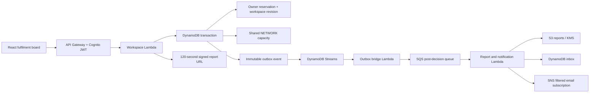

# Phase 6: rescue fulfilment

## User workflow

Sign in to the AWS workspace, open FR-101 in Rescue Lab, save a fresh analysis, review a feasible option, and choose **Reserve receiving capacity**. Open **Fulfilment** to dispatch the shipment, record delivery, download its private PDF report, inspect the timeline, and read notifications. A confirmed reservation can be cancelled before dispatch. Delivery and cancellation release its inbound allocation.

The page provides stage filters, active allocation metrics, operator-recorded delivery quantity, shared receiving capacity, an inbox with persisted read status, and versioned reports. Local mode keeps its original illustrative plan behavior and explains that cloud sign-in is needed for reservations.

## Cloud architecture

The private data bucket also receives CSV uploads with short-lived signed PUT URLs. Phase 5 imports use their own queue and worker; analysis jobs use the Standard Step Functions workflow. Phase 6 depends on saved server-calculated analyses.

## Correctness and security

- Every reservation belongs to the authenticated Cognito subject. Request bodies cannot choose another owner. Foreign run, reservation and report access returns 404.
- Receiving capacity lives in the Destinations table's shared `NETWORK` partition. Per-user receiving records from Phase 4 do not control cloud allocations. Existing historical snapshots are preserved; create a new analysis against the shared network before reserving.
- Quantities are whole grams, accepting at most three decimal places in kg. A transaction checks the selected destination version, updates capacity, writes the reservation, increments the owner workspace revision, creates a shipment lock and inserts an outbox event together.
- One active allocation per owner shipment is enforced by a conditional lock. Confirm retries return the existing reservation. Shipment edits are blocked while reserved; delivered shipments remain closed. Cancelling unlocks the shipment for a new analysis.
- Allowed transitions: CONFIRMED -> DISPATCHED -> DELIVERED, or CONFIRMED -> CANCELLED. Conditional reservation and destination versions prevent double release under concurrency. Repeating an already completed transition returns the existing state.
- Shared rule edits require the Cognito administrators group; reserved quantity is preserved and capacity cannot fall below it. Legacy command endpoints cannot bypass reservation or shared-network APIs.
- Private reports use the existing KMS-encrypted, versioned reports bucket. The API verifies owner and current reservation version before issuing a 120-second download link. Signed URLs are bearer capabilities during that period. Anonymous object requests are denied.
- Each status event creates immutable versioned PDF and JSON objects plus an inbox message. Processing leases and completion markers suppress ordinary queue duplicates. A crash after SNS publish but before the completion marker can produce a duplicate email; external delivery is at least once, not exactly once.
- The worker resolves the trusted username through Cognito, checks subject equality and `email_verified`, and publishes with a recipient attribute. The email subscription filters for the authorized project recipient. Another user's rescue details do not go to that recipient. Temporary QA users have unverified `example.invalid` emails, so live verification does not send their details to the project email.
- Stream filtering accepts only outbox INSERTs. Stream retry exhaustion goes to a dedicated failure queue. The post-decision queue has its own DLQ. Queue consumers use partial batch failure responses and concurrency limits.

## Evidence

`verification.json` records real HTTP tests with two temporary Cognito users. The initial run passed all 21 checks, including competing 500 kg requests against 600 kg capacity, repeat confirmation, access isolation, illegal transitions, report downloads, unsigned S3 denial, inbox read persistence, dispatch capacity retention, delivery and cancellation release, and status history. Five background events completed with SNS message IDs; actual Step Functions executions reached SUCCEEDED. Test users, owned rows and private test object versions were removed. Shared reserved capacity returned to zero.

The PDF layout was rendered locally and visually inspected. Build/type checks, infrastructure synthesis and 41 automated tests passed. The latest release evidence and any remaining manual checks are recorded alongside this document.

The final deployed artifact passed all 21 Phase 6 checks plus all 10 CSV-import checks in `final-verification.json` after the original account was reconnected. Cleanup was verified again: no temporary Phase 6 users remain and test receiving capacity returned to zero. See [RELEASE_STATUS.md](RELEASE_STATUS.md) for the remaining email/browser manual checks and the resolved account-connection history.

## Limits and demonstration honesty

The receiving network is fictional. Its capacity represents active inbound space, not dated booking slots or actual partner acceptance. Hours are same-day IST windows. Delivery is an operator assertion. The Q10/cohort loss estimate is illustrative; delivered mass is not measured waste prevented and the report is not food-safety certification. Phase 7 Bedrock integration remains planned.

Email requires SNS confirmation and a verified Cognito sign-in email matching the configured project subscription. SNS acceptance of a publish does not prove inbox delivery. CloudFront remains blocked by AWS account verification; the approved HTTPS fallback is in use. No browser security settings are weakened.

## Operations and recovery

CloudWatch groups `/freshroute/outboxbridge` and `/freshroute/postdecisionworker` retain seven days of logs. Inspect errors before redriving a DLQ. An outbox stream failure message contains a stream record reference; use its owner and outbox ID to re-enqueue the durable outbox entry into `FreshRoutePostDecision`. Reprocessing cannot change capacity: only reservation API transactions do so. Processed events skip report/notification work. Preserve stateful buckets, tables and KMS key; do not delete the shared network to recover a worker failure.

Queue retention is four days, DLQs retain fourteen days, stream records have a finite retention window, and reports expire after thirty days. Outbox entries remain available for controlled recovery. Report and notification objects do not modify the owner's workspace revision. No CloudWatch alarms/dashboard, automatic DLQ redrive, daily capacity reset, live routing feed or LLM is claimed in this phase.

## Deployment

Infrastructure is defined in `infrastructure/app.ts`, `workflows.ts` and `fulfilment.ts`. All stateful resources retain their existing identities. CloudFormation change sets were reviewed before execution; no table, bucket, pool or key was replaced. `scripts/prepare-templates.mjs` removes diagnostic CDK path metadata so inline templates fit CloudFormation's size limit. Lambda artifacts are uploaded privately with S3 object versions pinned through CloudFormation parameters. The notification email is a NoEcho deployment parameter and is not hardcoded in source.
