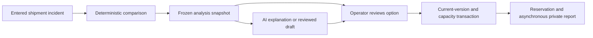
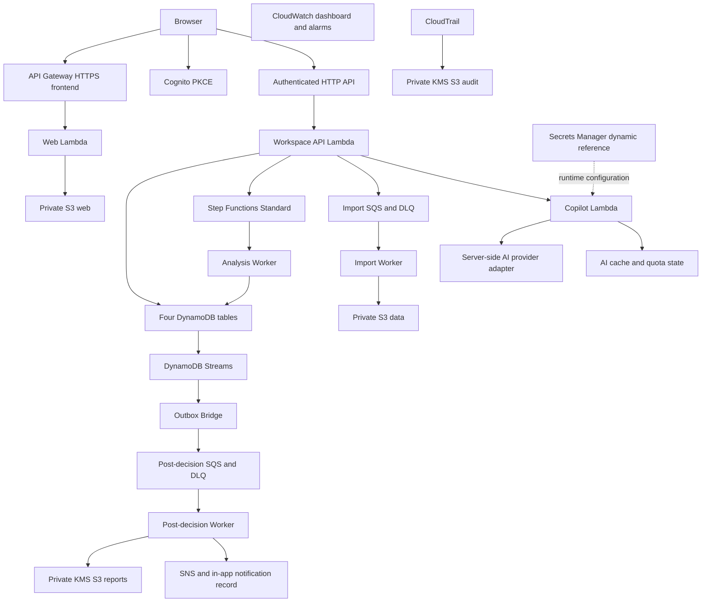
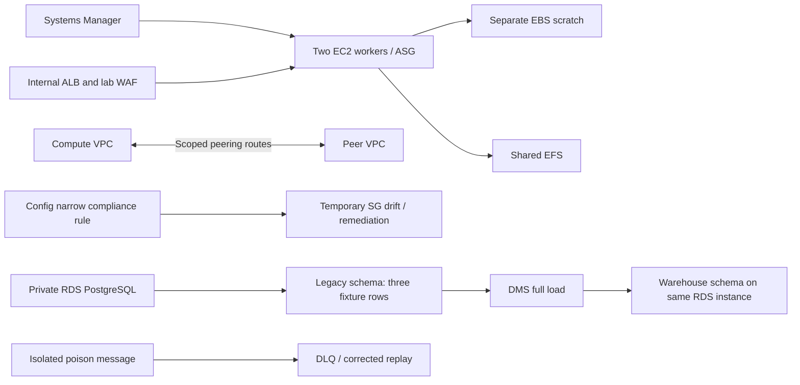

# Editable FreshRoute diagrams

## Business decision

## Retained application

CloudFront remains blocked by account verification; the HTTPS fallback is the deployed frontend. CloudWatch observes relevant services; lines are omitted to keep the diagram readable. The fourth DynamoDB table stores Activity, jobs, notifications and AI state. Email publish and actual email delivery are separate observations.

## Verified and deleted labs

All five lab stacks were deleted after verification. Multi-AZ RDS, read replicas, Aurora, Direct Connect, SWF, Shield experiments and historical/physical migration services are studies rather than resources in these diagrams. The DMS flow was not CDC or a production cutover.
